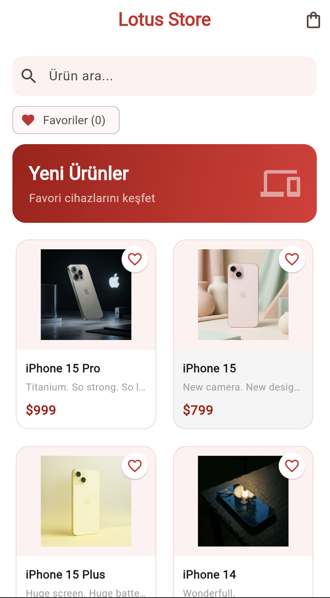
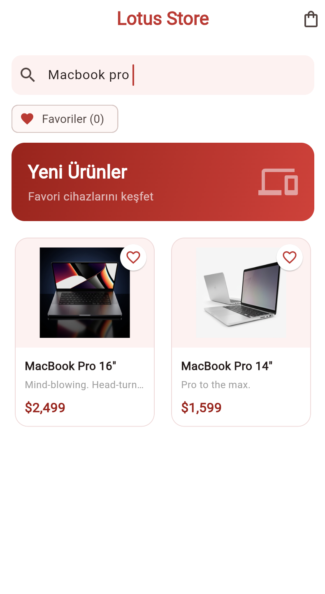
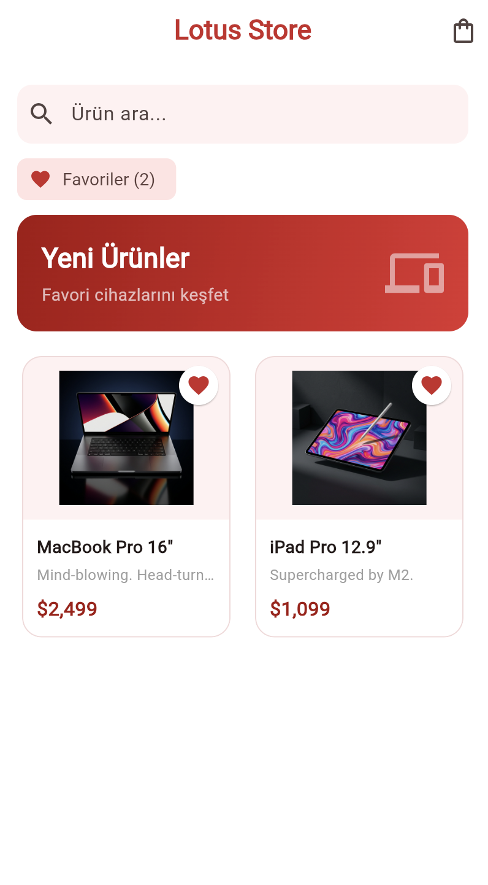
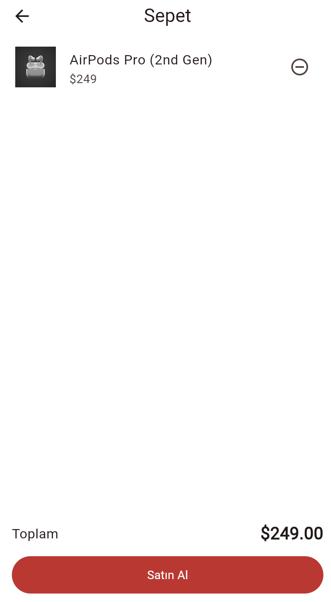
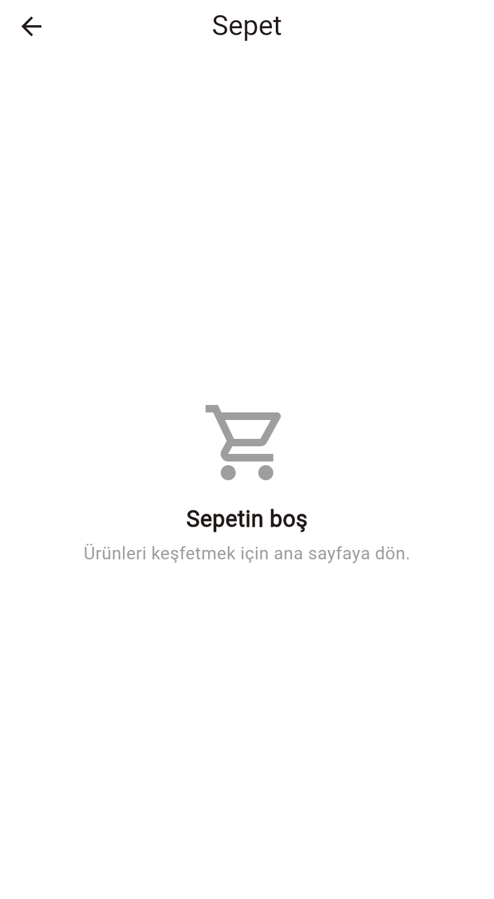

# Lotus Store – Mini Catalog App

[Türkçe sürüm](README.tr.md)

A simple mobile product catalog app built with Flutter. This is the final project of a Flutter training course.

## Short Description

The app reads products from a local JSON file and shows them in a grid. You can search products, mark them as favorites, open a product detail page and add products to a cart. The cart and favorites are simulations: the data lives in memory and is reset when the app is closed. The app interface is in Turkish.

## Features

- Home page with a banner, a search box and a product grid (`GridView`)
- Search by product name and tagline
- Favorites: heart button on every product and a "Favoriler" filter
- Product detail page, with the product passed as a route argument
- Cart: add and remove products, total price, empty cart screen
- JSON parsing with a model class (`fromJson` / `toJson`)
- Named routes for page navigation
- No extra packages, only `material.dart`

## Flutter Version

Flutter FLUTTER_VERSION (stable)

## Development Environment

- Flutter SDK and Dart SDK
- Visual Studio Code
- Tested in Chrome (mobile device mode) and on a physical phone through the browser (`flutter run -d web-server`)

## Getting Started

1. Install the Flutter SDK: https://docs.flutter.dev/get-started/install
2. Clone the project:
   ```bash
   git clone https://github.com/hazalbuber/mini_catalog.git
   cd mini_catalog
   ```
3. Install the dependencies:
   ```bash
   flutter pub get
   ```
4. Run the app in Chrome:
   ```bash
   flutter run -d chrome
   ```
   To try it on a phone, serve it on your local network:
   ```bash
   flutter run -d web-server --web-hostname 0.0.0.0 --web-port 8080
   ```
   Then open `http://YOUR_COMPUTER_IP:8080` in the phone's browser (both devices must be on the same Wi-Fi network).

An internet connection is needed because the product images are loaded from the web.

## Project Structure

```
lib/
├── main.dart                   # App entry, theme and named routes
├── theme.dart                  # Brand colors
├── models/
│   └── product.dart            # Product model
├── data/
│   ├── product_service.dart    # Reads assets/products.json
│   ├── cart_store.dart         # Cart state
│   └── favorites_store.dart    # Favorites state
├── pages/
│   ├── home_page.dart          # Product grid, search and favorites filter
│   ├── product_detail_page.dart
│   └── cart_page.dart
└── widgets/
    ├── product_card.dart
    ├── cart_button.dart
    ├── favorite_button.dart
    └── network_picture.dart    # Network image with a web fallback
assets/
└── products.json               # Product data
```

## Data Source

The product data comes from the educational mock API `https://wantapi.com/products.php` and is saved locally in `assets/products.json`. The data is for education and testing only and does not represent a real e-commerce backend. Product names and trademarks belong to their respective owners.

## Screenshots

<table align="center">
  <tr>
    <td align="center"></td>
    <td align="center"></td>
    <td align="center"></td>
  </tr>
  <tr>
    <td align="center"><b>Home</b><br>Banner, search and product grid</td>
    <td align="center"><b>Search</b><br>Filter products by name</td>
    <td align="center"><b>Favorites</b><br>Favorites filter with hearted products</td>
  </tr>
</table>

<table align="center">
  <tr>
    <td align="center"></td>
    <td align="center"></td>
    <td align="center"></td>
    <td align="center"></td>
  </tr>
  <tr>
    <td align="center"><b>Product detail</b><br>Image, price and description</td>
    <td align="center"><b>Specifications</b><br>Detail page scrolled down</td>
    <td align="center"><b>Cart</b><br>Items and total price</td>
    <td align="center"><b>Empty cart</b><br>Shown when the cart has no items</td>
  </tr>
</table>
