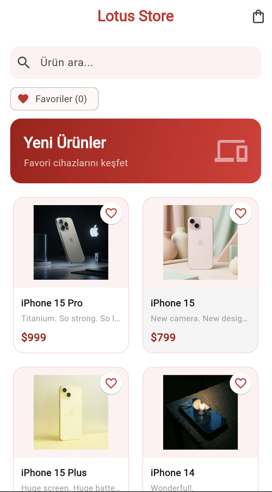
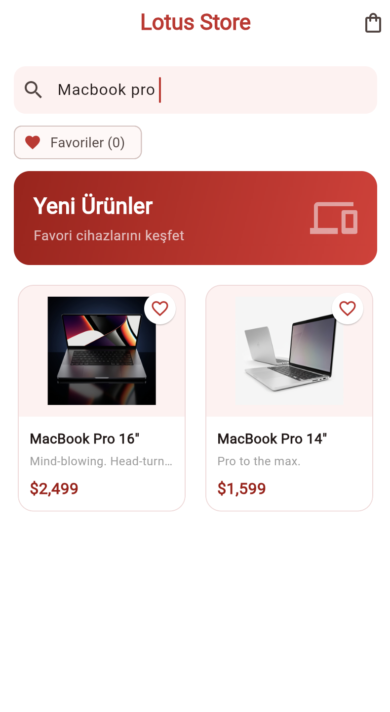
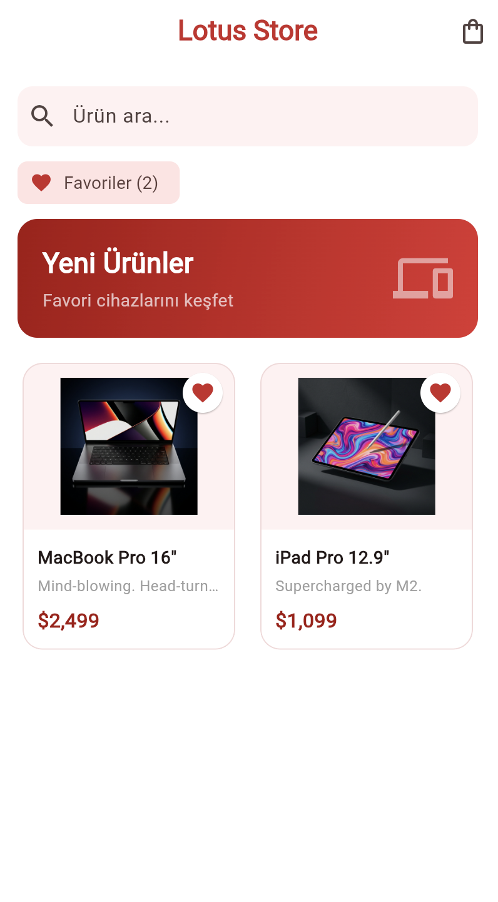
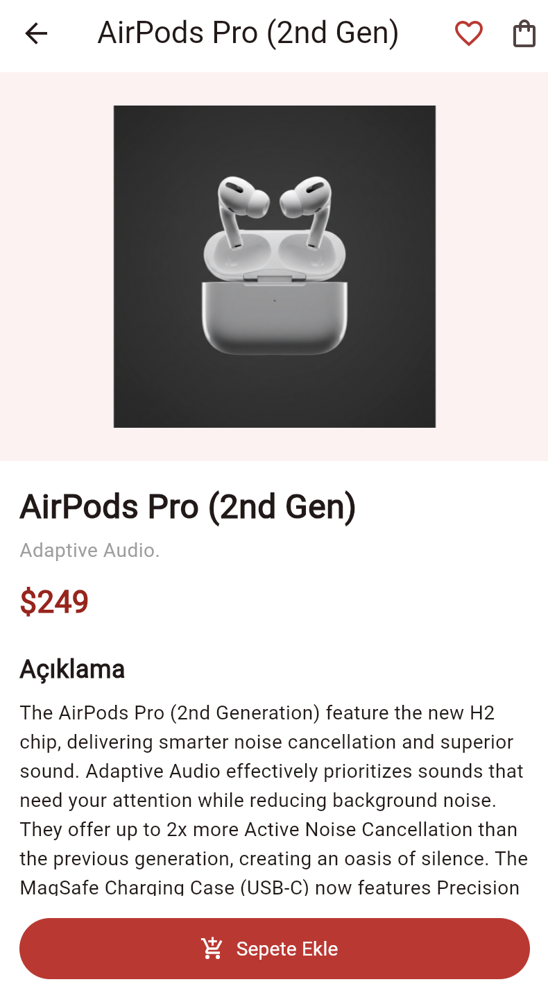
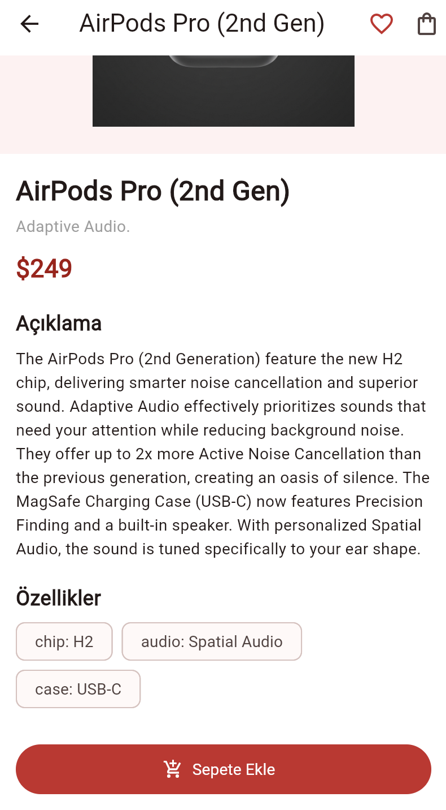
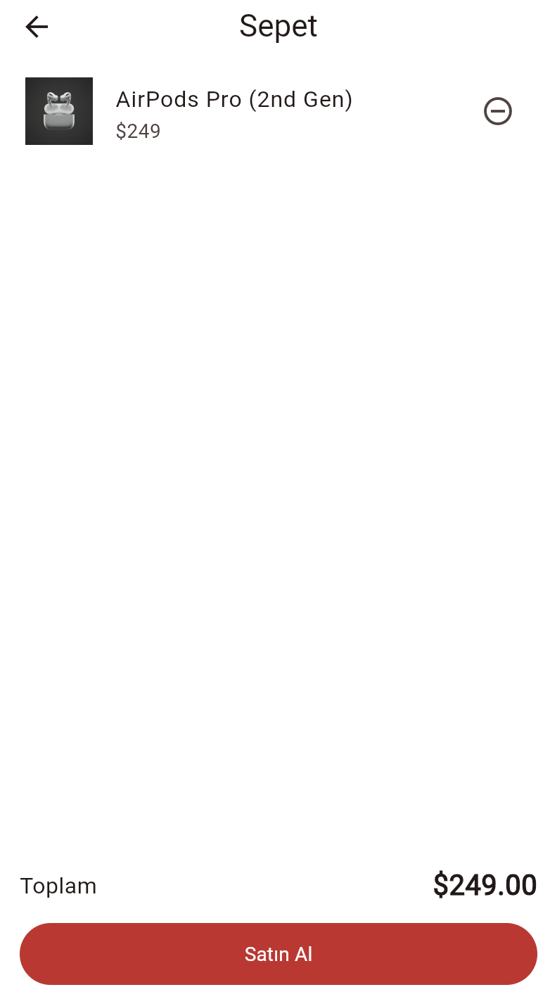
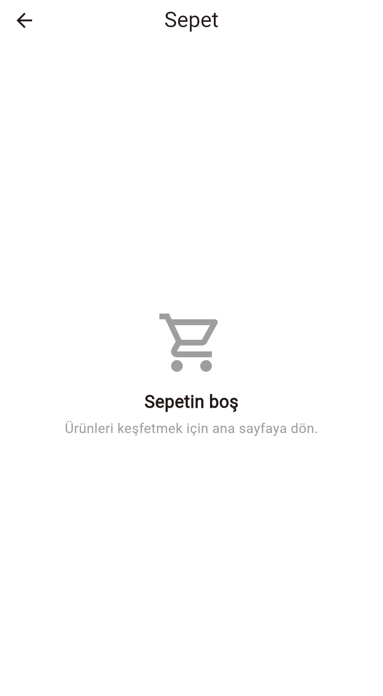

# Lotus Store – Mini Katalog Uygulaması

[English version](README.md)

Flutter ile geliştirilmiş basit bir mobil ürün katalog uygulaması. Bu proje, bir Flutter eğitiminin bitirme projesidir.

## Kısa Açıklama

Uygulama ürünleri yerel bir JSON dosyasından okur ve bir ızgara (grid) içinde gösterir. Ürünlerde arama yapabilir, favorilere ekleyebilir, ürün detay sayfasını açabilir ve sepete ürün ekleyebilirsiniz. Sepet ve favoriler birer simülasyondur: veriler bellekte tutulur ve uygulama kapatılınca sıfırlanır. Uygulama arayüzü Türkçedir.

## Özellikler

- Banner, arama kutusu ve ürün ızgarası (`GridView`) içeren ana sayfa
- Ürün adına ve sloganına göre arama
- Favoriler: her üründe kalp düğmesi ve "Favoriler" filtresi
- Ürün detay sayfası, ürün rota argümanı olarak aktarılır
- Sepet: ürün ekleme ve çıkarma, toplam fiyat, boş sepet ekranı
- Model sınıfı ile JSON ayrıştırma (`fromJson` / `toJson`)
- Sayfa geçişleri için isimlendirilmiş rotalar (named routes)
- Ek paket yok, yalnızca `material.dart`

## Flutter Sürümü

Flutter FLUTTER_VERSION (stable)

## Geliştirme Ortamı

- Flutter SDK ve Dart SDK
- Visual Studio Code
- Chrome'da (mobil cihaz modu) ve tarayıcı üzerinden gerçek telefonda test edildi (`flutter run -d web-server`)

## Başlarken

1. Flutter SDK'yı kurun: https://docs.flutter.dev/get-started/install
2. Projeyi klonlayın:
   ```bash
   git clone https://github.com/hazalbuber/mini_catalog.git
   cd mini_catalog
   ```
3. Bağımlılıkları kurun:
   ```bash
   flutter pub get
   ```
4. Uygulamayı Chrome'da çalıştırın:
   ```bash
   flutter run -d chrome
   ```
   Telefonda denemek için yerel ağınızda yayınlayın:
   ```bash
   flutter run -d web-server --web-hostname 0.0.0.0 --web-port 8080
   ```
   Sonra telefonun tarayıcısında `http://BILGISAYARIN_IP_ADRESI:8080` adresini açın (iki cihaz aynı Wi-Fi ağında olmalıdır).

Ürün görselleri internetten yüklendiği için internet bağlantısı gerekir.

## Proje Yapısı

```
lib/
├── main.dart                   # Uygulama girişi, tema ve isimlendirilmiş rotalar
├── theme.dart                  # Marka renkleri
├── models/
│   └── product.dart            # Ürün modeli
├── data/
│   ├── product_service.dart    # assets/products.json dosyasını okur
│   ├── cart_store.dart         # Sepet durumu
│   └── favorites_store.dart    # Favoriler durumu
├── pages/
│   ├── home_page.dart          # Ürün ızgarası, arama ve favoriler filtresi
│   ├── product_detail_page.dart
│   └── cart_page.dart
└── widgets/
    ├── product_card.dart
    ├── cart_button.dart
    ├── favorite_button.dart
    └── network_picture.dart    # Web için yedekli ağ görseli
assets/
└── products.json               # Ürün verileri
```

## Veri Kaynağı

Ürün verileri, eğitim amaçlı sahte API olan `https://wantapi.com/products.php` adresinden alınmış ve `assets/products.json` dosyasına yerel olarak kaydedilmiştir. Veriler yalnızca eğitim ve test içindir, gerçek bir e-ticaret altyapısını temsil etmez. Ürün adları ve markalar ilgili sahiplerine aittir.

## Ekran Görüntüleri

<table align="center">
  <tr>
    <td align="center"></td>
    <td align="center"></td>
    <td align="center"></td>
  </tr>
  <tr>
    <td align="center"><b>Ana sayfa</b><br>Banner, arama ve ürün ızgarası</td>
    <td align="center"><b>Arama</b><br>Ürünleri ada göre filtreleme</td>
    <td align="center"><b>Favoriler</b><br>Kalp eklenen ürünlerin filtresi</td>
  </tr>
</table>

<table align="center">
  <tr>
    <td align="center"></td>
    <td align="center"></td>
    <td align="center"></td>
    <td align="center"></td>
  </tr>
  <tr>
    <td align="center"><b>Ürün detayı</b><br>Görsel, fiyat ve açıklama</td>
    <td align="center"><b>Özellikler</b><br>Detay sayfası aşağı kaydırılmış</td>
    <td align="center"><b>Sepet</b><br>Ürünler ve toplam fiyat</td>
    <td align="center"><b>Boş sepet</b><br>Sepette ürün yokken gösterilir</td>
  </tr>
</table>
